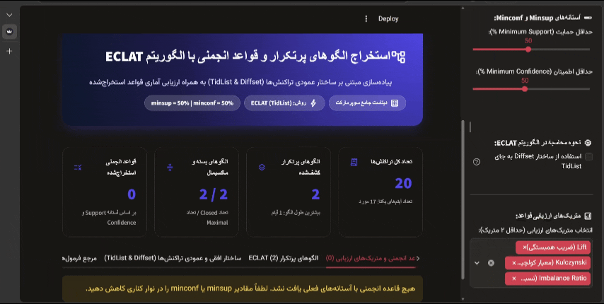
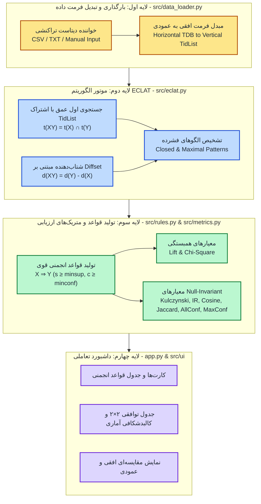
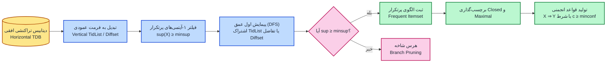

<div align="center">

# 📊 سامانه استخراج الگوهای پرتکرار و قواعد انجمنی با الگوریتم ECLAT
### ECLAT Frequent Pattern & Association Rule Mining Engine

**پیاده‌سازی الگوریتم ECLAT مبتنی بر ساختار عمودی تراکنش‌ها (TidList & Diffset)، استخراج الگوهای بسته و ماکسیمال و ارزیابی آماری قواعد انجمنی**

[](https://www.python.org/)
[](https://streamlit.io/)
[-4F46E5?style=for-the-badge)](https://github.com/)
[](https://github.com/)
[](#-اجرای-تست‌های-خودکار-unit-tests)
[](./LICENSE)

**توسعه‌دهنده:** [KianShojaei](https://github.com/KianShojaei) &nbsp;|&nbsp; **پروژه درس:** داده‌کاوی (Data Mining)

</div>

---

## 🎯 معرفی و هدف پروژه

کشف الگوهای پرتکرار (Frequent Pattern Mining) و استخراج قواعد انجمنی (Association Rule Mining) از بنیادی‌ترین مباحث داده‌کاوی در تحلیل سبد خرید (Market Basket Analysis)، تحلیل لاگ‌های وب و سیستم‌های توصیه‌گر است. برخلاف الگوریتم سنتی Apriori که بر فرمت افقی داده‌ها تکیه دارد و نیازمند اسکن‌های چندباره پایگاه داده و تولید کاندیداهای پرشمار است، الگوریتم **ECLAT (Equivalence Class Transformation)** داده‌ها را به **فرمت عمودی (Vertical Data Format)** تبدیل کرده و با استفاده از جستجوی اول عمق (DFS) و اشتراک مجموعه‌های شناسه تراکنش‌ها (`TidList Intersection` و `Diffset`)، الگوهای پرتکرار را با سرعت بسیار بالا استخراج می‌کند.

این پروژه یک سامانه کامل و تعاملی است که با دریافت هرگونه دیتاست تراکنشی و مقادیر آستانه **`minsup`** و **`minconf`**، تمامی الگوهای پرتکرار (به همراه تشخیص الگوهای فشرده **Closed** و **Maximal**)، قواعد انجمنی قوی ($X \Rightarrow Y$) و **۸ متریک ارزیابی استاندارد** (از جمله معیارهای دارای خاصیت **Null-Invariance**) را محاسبه و مصورسازی می‌نماید.

---

## 🎥 ویدیوی دموی محیط برنامه (Project Demo Video)

در پیش‌نمایش زنده زیر می‌توانید نحوه کارکرد سامانه، تبدیل دیتابیس افقی به عمودی (`TidList` و `Diffset`)، استخراج الگوهای پرتکرار و قواعد انجمنی و تحلیل جدول توافقی ۲×۲ را مشاهده فرمایید:

<div align="center">
  <a href="https://github.com/KianShojaei/eclat-association-rule-miner/raw/main/Video/demo.mkv">
    
  </a>
  <br/><br/>
  <p>🎬 <b><a href="https://github.com/KianShojaei/eclat-association-rule-miner/raw/main/Video/demo.mkv">▶️ مشاهده یا دانلود ویدیوی کامل دمو با کیفیت اصلی (Video/demo.mkv)</a></b></p>
</div>

---

## 📌 معماری کلان سیستم (System Architecture)

معماری این سامانه در ۴ لایه مستقل و ماژولار طراحی شده است:



---

## ⚙️ تشریح الگوریتم ECLAT و تکنیک Diffset (`src/eclat.py`)

### ۱. تبدیل دیتابیس افقی به فرمت عمودی (Vertical Data Format)
در دیتابیس‌های تراکنشی متداول (فرمت افقی)، هر رکورد شامل یک شناسه تراکنش (`TID`) و فهرست اقلام آن تراکنش است. الگوریتم ECLAT در گام نخست با یک بار پیمایش دیتابیس، ساختار داده را به صورت عمودی (`Item -> TidList`) بازآرایی می‌کند:

| فرمت افقی (Horizontal Format) | فرمت عمودی (Vertical TidList) | تفاضل تراکنش‌ها (Diffset) |
| :--- | :--- | :--- |
| `T10: a, c, d, e` | `a: {T10, T20}` (sup=2) | `d(a) = {T30}` |
| `T20: a, b, e` | `b: {T20, T30}` (sup=2) | `d(b) = {T10}` |
| `T30: b, c, e` | `c: {T10, T30}` (sup=2) | `d(c) = {T20}` |
| | `d: {T10}` (sup=1) | `d(d) = {T20, T30}` |
| | `e: {T10, T20, T30}` (sup=3) | `d(e) = ∅` |

### ۲. جستجوی اول عمق (DFS) و اشتراک مجموعه‌ها
در هر کلاس هم‌ارزی (Equivalence Class)، برای ساختن الگوهای $(k+1)$-آیتمی از الگوهای $k$-آیتمی، تنها کافی است اشتراک مجموعه‌های `TidList` دو الگو محاسبه شود:

$$t(X \cup Y) = t(X) \cap t(Y), \qquad \text{sup}(X \cup Y) = |t(X \cup Y)|$$

بر اساس خاصیت بستار رو به پایین (Downward Closure / Apriori Property)، اگر اندازه اشتراک کمتر از آستانه $\text{minsup}$ باشد، آن شاخه در درخت جستجوی DFS بلافاصله هرس (Prune) می‌شود.

### ۳. شتاب‌دهی با تکنیک Diffset
در دیتاست‌های متراکم که لیست‌های `TidList` بسیار طولانی می‌شوند، نگهداری و اشتراک‌گیری از کل شناسه‌ها حافظه زیادی مصرف می‌کند. در حالت **Diffset**، به جای نگهداری تراکنش‌های حاوی الگو، تنها **تفاضل تراکنش‌ها** نسبت به پیشوند والد نگهداری می‌شود:

$$\text{Diffset}(XY, X) = d(Y) - d(X), \qquad \text{sup}(XY) = \text{sup}(X) - |\text{Diffset}(XY, X)|$$

### ۴. تشخیص الگوهای فشرده: Closed Patterns و Max-Patterns
* **الگوی بسته (Closed Pattern):** الگوی پرتکرار $X$ بسته است اگر هیچ ابرالگوی سره $Y \supset X$ با **همان مقدار حمایت (Support) یکسان** وجود نداشته باشد (فشرده‌سازی بدون اتلاف اطلاعات / Lossless Compression).
* **الگوی ماکسیمال (Max-Pattern):** الگوی پرتکرار $X$ ماکسیمال است اگر هیچ ابرالگوی سره $Y \supset X$ پرتکراری وجود نداشته باشد (فشرده‌سازی با اتلاف اطلاعات Support زیرالگوها / Lossy Compression).



---

## 📐 استخراج قواعد انجمنی و متریک‌های ارزیابی (`src/rules.py` & `src/metrics.py`)

پس از کشف تمامی مجموعه‌آیتم‌های پرتکرار $I$ با طول $k \ge 2$، تمامی زیرمجموعه‌های غیرتهی $X \subset I$ تولید شده و قاعده $X \Rightarrow Y$ (که در آن $Y = I - X$) تشکیل می‌گردد.

### ۱. معیارهای پایه (Support & Confidence)

$$\text{Support}(X \Rightarrow Y) = s(X \cup Y) = \frac{\text{sup}(X \cup Y)}{|TDB|}$$

$$\text{Confidence}(X \Rightarrow Y) = P(Y \mid X) = \frac{\text{sup}(X \cup Y)}{\text{sup}(X)} = \frac{s(X \cup Y)}{s(X)}$$

### ۲. محدودیت چارچوب Support-Confidence و اهمیت متریک‌های ارزیابی
صرفِ بالا بودن Support و Confidence همیشه به معنای همبستگی مثبت واقعی نیست (ممکن است احتمال پیشین وقوع $Y$ به خودی خود از $P(Y \mid X)$ بیشتر باشد). همچنین در پایگاه‌های داده بزرگ، تعداد **تراکنش‌های خنثی (Null-Transactions)** — یعنی تراکنش‌هایی که نه شامل $X$ هستند و نه شامل $Y$ ($\neg X \neg Y$) — بسیار زیاد است؛ بنابراین استفاده از معیارهای **Null-Invariant** (مستقل از تراکنش‌های خنثی) اهمیت حیاتی دارد.

در این پروژه، **۸ متریک ارزیابی** به صورت کامل پیاده‌سازی شده‌اند:

| نام متریک | فرمول ریاضی | بازه مقادیر | خاصیت Null-Invariant | کاربرد و تفسیر آماری |
| :--- | :--- | :---: | :---: | :--- |
| **Lift** | $$\frac{s(X \cup Y)}{s(X) \times s(Y)}$$ | $[0, \infty)$ | خیر (No) | بررسی استقلال ($=1$)، همبستگی مثبت ($>1$) یا منفی ($<1$) |
| **Chi-Square ($\chi^2$)** | $$\sum \frac{(\text{Obs} - \text{Exp})^2}{\text{Exp}}$$ | $[0, \infty)$ | خیر (No) | آزمون آماری وابستگی روی جدول توافقی ۲×۲ |
| **Kulczynski (Kulc)** | $$\frac{1}{2}\left(\frac{s(X \cup Y)}{s(X)} + \frac{s(X \cup Y)}{s(Y)}\right)$$ | $[0, 1]$ | **بله (Yes)** | میانگین احتمالات شرطی دوطرفه؛ بهترین معیار متوازن و Null-Invariant |
| **Imbalance Ratio (IR)** | $$\frac{|s(X) - s(Y)|}{s(X) + s(Y) - s(X \cup Y)}$$ | $[0, 1]$ | **بله (Yes)** | سنجش میزان عدم تقارن بین فراوانی $X$ و $Y$ (مکمل مستقیم Kulczynski) |
| **Cosine** | $$\frac{s(X \cup Y)}{\sqrt{s(X) \times s(Y)}}$$ | $[0, 1]$ | **بله (Yes)** | میانگین هندسی احتمالات شرطی دوطرفه |
| **Jaccard** | $$\frac{s(X \cup Y)}{s(X) + s(Y) - s(X \cup Y)}$$ | $[0, 1]$ | **بله (Yes)** | نسبت اشتراک به اجتماع تراکنش‌های شامل $X$ و $Y$ |
| **AllConfidence** | $$\frac{s(X \cup Y)}{\max(s(X), s(Y))}$$ | $[0, 1]$ | **بله (Yes)** | کران پایین اطمینان دوطرفه $\min(P(Y\mid X), P(X\mid Y))$ |
| **MaxConfidence** | $$\max\left(\frac{s(X \cup Y)}{s(X)}, \frac{s(X \cup Y)}{s(Y)}\right)$$ | $[0, 1]$ | **بله (Yes)** | کران بالای اطمینان دوطرفه $\max(P(Y\mid X), P(X\mid Y))$ |

---

## 📂 ساختار درختی پروژه (Project Structure)

```text
eclat-association-rule-miner/
├── Video/
│   ├── demo.gif                # پیش‌نمایش متحرک زنده در README
│   └── demo.mkv                # ویدیوی کامل دموی محیط برنامه
├── data/                       # دیتاست‌های تراکنشی نمونه (کم‌حجم CSV)
│   ├── slide6_market.csv       # دیتاست ۵ تراکنشی اقلام روزمره
│   ├── slide26_eclat.csv       # دیتاست پایه آزمون TidList و Diffset
│   ├── slide21_apriori.csv     # دیتاست کلاسیک ۴ تراکنشی
│   └── supermarket_basket.csv  # دیتاست ۲۰ تراکنشی سبد خرید سوپرمارکت
│
├── app.py                      # نقطه ورود اصلی اپلیکیشن Streamlit
├── config.py                   # تنظیمات دیتاست‌ها و لیست متریک‌ها
├── requirements.txt            # وابستگی‌های پایتون
├── LICENSE                     # مجوز انتشار MIT
├── README.md                   # مستندات جامع پروژه
│
├── src/
│   ├── __init__.py
│   ├── data_loader.py          # پارسر CSV/TXT و مبدل افقی به عمودی (TidList)
│   ├── eclat.py                # پیاده‌سازی الگوریتم ECLAT (TidList, Diffset, Closed, Max)
│   ├── rules.py                # موتور استخراج قواعد انجمنی (X ⇒ Y)
│   ├── metrics.py              # محاسبات ۸ متریک ارزیابی و جدول توافقی ۲×۲
│   └── ui/
│       ├── __init__.py
│       ├── styles.py           # استایل‌های تطبیقی CSS، فونت وزیرمتن و تنظیمات RTL/LTR
│       └── components.py       # کامپوننت‌های بصری کارت‌ها، جداول و فرمول‌ها
│
└── tests/                      # مجموعه تست‌های واحد خودکار (Pytest)
    ├── __init__.py
    ├── test_eclat_and_slides.py # تست‌های صحت ریاضی الگوریتم ECLAT، قواعد و متریک‌ها
    └── test_ui_and_loader.py    # تست‌های الگوهای Closed/Max و رابط کاربری
```

---

## 🚀 راهنمای نصب و اجرا (Quickstart Guide)

### ۱. دریافت پروژه و ساخت محیط مجازی (`.venv`)
```powershell
git clone https://github.com/KianShojaei/eclat-association-rule-miner.git
cd eclat-association-rule-miner

python -m venv .venv
# فعال‌سازی در ویندوز (PowerShell):
.\.venv\Scripts\Activate.ps1
# فعال‌سازی در لینوکس یا مک:
# source .venv/bin/activate
```

### ۲. نصب کتابخانه‌های مورد نیاز
```powershell
pip install -r requirements.txt
```

### ۳. اجرای تست‌های خودکار (Unit Tests)
```powershell
pytest tests/ -v
```
خروجی:
```text
tests/test_eclat_and_slides.py ....... PASSED
tests/test_ui_and_loader.py ..         PASSED
========================= 9 passed in 0.30s =========================
```

### ۴. اجرای برنامه تحت وب (Streamlit Web App)
```powershell
streamlit run app.py
```
سپس برنامه در آدرس **`http://localhost:8501`** در مرورگر شما باز خواهد شد.

---

## 📜 مجوز انتشار (License)

این پروژه تحت مجوز **[MIT License](./LICENSE)** منتشر شده است.

---

<div align="center">

ساخته‌شده توسط [**KianShojaei**](https://github.com/KianShojaei)

⭐ اگر این پروژه برایتان مفید بود، یک ستاره (Star) در گیت‌هاب بدهید.

</div>
